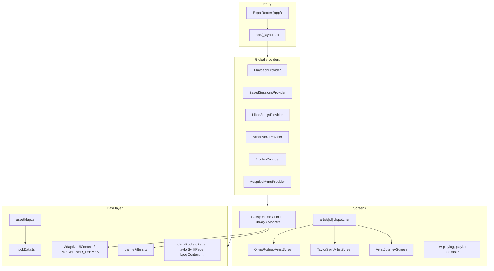

# Amazon Music Adaptive UI

High-fidelity React Native prototype of the Amazon Music mobile client, extended with a custom **Adaptive UI** layer that reshapes home-screen content from listener personas and fandom themes.


> Academic UI prototype. Not affiliated with, endorsed by, or connected to Amazon or Amazon Music.

---

## What this is

This is a **deliberately engineered UI clone**:

- **Expo Router** file-based navigation with a typed route tree
- **React Context** providers for playback, profiles, likes, saved sessions, and adaptive themes
- **Central mock catalog** (`src/data/mockData.ts`) driving songs, artists, playlists, and podcasts
- **Static asset registry** (`src/data/assetMap.ts`) with Metro `require()` bindings for album art, artist photos, nav icons, and player chrome
- **Theme engine** (`src/context/AdaptiveUIContext.tsx`) that filters and re-labels home content per persona
- **Hand-tuned artist screens** for high-fidelity superfan flows (Olivia Rodrigo, Taylor Swift) plus a generic `ArtistJourneyScreen` for all other artist IDs

There is **no backend**, **no real audio streaming**, and **no authentication API**. Playback is simulated with a global timer and in-memory state.

---

## Architecture



### Provider tree

Nested in `app/_layout.tsx` (outermost to innermost):

1. `PlaybackProvider` — play/pause, track index, skip; progress split into a separate context so the 300ms timer does not re-render every screen
2. `SavedSessionsProvider` — Maestro / saved listening sessions
3. `LikedSongsProvider` — liked song IDs
4. `AdaptiveUIProvider` — active adaptive theme, persona state, superfan unlock flags
5. `ProfilesProvider` — multi-profile / identity switching
6. `AdaptiveMenuProvider` — long-press context menu for theme actions

`AutoLikeCurrentSong` in the root layout adds the current track to Liked Songs on **user-initiated** track changes only (`manualChangeRef` gates passive auto-advance).

### Adaptive UI

`PREDEFINED_THEMES` in `AdaptiveUIContext.tsx` define:

- Hero copy (title, subtitle, eyebrow) and accent hue
- `filterArtistIds`, `filterGenre(s)`, `filterMoods` for catalog scoping
- Per-theme `sectionLabels` (e.g. K-pop vs casual listener copy)
- Optional `heroBannerKey` resolved through `assetMap.ts`

Home (`app/(tabs)/index.tsx`) selects a surface:

- `CasualHome` — default Amazon Music–style grid
- `AdaptivePersonaHome` — persona-driven adaptive layout
- `RabiatAdaptiveHome` — profile-specific adaptive variant

`themeFilters.ts` applies theme constraints to songs, albums, artists, and continue-listening rows from `mockData.ts`.

### Artist routing

`app/artist/[id].tsx` dispatches by ID:

| Artist ID | Screen |
|-----------|--------|
| `olivia-rodrigo` | `OliviaRodrigoArtistScreen` + `OliviaMusicTab` / `OliviaAboutTab` |
| `tswift` | `TaylorSwiftArtistScreen` + `TaylorMusicTab` |
| all others | `ArtistJourneyScreen` (eras, merch, about derived from `mockData` + `artistPages.ts`) |

### Playback simulation

`src/hooks/usePlaybackState.tsx`:

- `PlaybackControlsContext` — `isPlaying`, `currentSongIdx`, `playSongAt`, `skipNext` / `skipPrev`
- `PlaybackProgressContext` — `nowPlayingProgress` updated on a 300ms interval
- No audio files; duration parsed from mock metadata via `parseDurationSeconds`

### Asset pipeline

`src/data/assetMap.ts` exports:

- `albumArtAssets` — keyed album art for rails, playlists, and hero banners
- `artistAssets` — artist profile and avatar images
- `playerIconAssets`, `navIconAssets`, `logoAssets` — UI chrome
- `oliviaPageAssets`, `oliviaAboutAssets` — hand-tuned Olivia Rodrigo page media

Metro bundles assets through static `require()` paths. Missing files under `assets/album-art/` or `assets/artists/` will fail the bundler.

---

## File structure

```
app/
  _layout.tsx                 # Provider tree, Ember fonts, stack navigator
  index.tsx                   # Splash / entry
  (tabs)/
    _layout.tsx               # Bottom tabs + custom AmazonTabBar
    index.tsx                 # Home (adaptive + casual)
    search.tsx                # Find
    library.tsx               # Library
    maestro.tsx               # Maestro surface
  artist/[id].tsx             # Artist screen dispatcher
  artist-discography/[id].tsx
  playlist/[id].tsx
  now-playing.tsx
  announcement.tsx
  podcast.tsx
  podcast-category/[id].tsx
  podcast-show/[id].tsx
  podcast-player/[id].tsx
  genre/[id].tsx
  session/[id].tsx
  liked.tsx
  create-profile.tsx
  music.tsx

src/
  components/                 # MiniPlayer, HRail, headers, adaptive controls
  components/home/            # CasualHome, AdaptivePersonaHome, RabiatAdaptiveHome
  components/artist/          # OliviaMusicTab, TaylorMusicTab, ArtistAboutTab, ...
  context/                    # AdaptiveUI, Profiles, LikedSongs, SavedSessions
  hooks/                      # usePlaybackState
  screens/                    # Hand-tuned + generic artist screens
  data/
    mockData.ts               # Canonical mock catalog
    assetMap.ts               # Metro require() registry
    themeFilters.ts           # Theme-scoped filters
    artistPages.ts            # Generic artist page builder
    oliviaRodrigoPage.ts, taylorSwiftPage.ts, kpopContent.ts, ...
  theme.ts                    # Color tokens, radii, typography helpers

assets/
  nav/                        # Tab bar icons
  player/                     # Mini-player + now-playing controls
  logos/                      # Amazon Music logos
  album-art/                  # Album and banner images
  artists/                    # Artist photos and Olivia about media
  fonts/                      # Ember Modern brand fonts
  icon.png, splash.png, adaptive-icon.png

scripts/
  optimize-images.mjs
  download-latest-apk.mjs
```

---

## Tech stack

| Layer | Choice |
|-------|--------|
| Framework | React Native 0.81, Expo SDK 54 |
| Navigation | Expo Router 6, React Navigation bottom tabs |
| Language | TypeScript |
| Gestures / animation | react-native-gesture-handler, react-native-reanimated |
| Images | expo-image (`AppImage` wrapper) |
| Fonts | Ember Modern (Amazon Music brand fonts in `assets/fonts/`) |
| Builds | EAS Build (optional APK via `npm run build:android`) |

---

## Getting started

### Prerequisites

- Node.js LTS
- npm
- [Expo Go](https://expo.dev/go) (physical device) or iOS Simulator / Android emulator

### Install and run

```bash
npm install
npm start
```

- Press `i` — iOS simulator
- Press `a` — Android emulator
- Scan QR — Expo Go on a physical device

### Scripts

| Command | Purpose |
|---------|---------|
| `npm start` | Start Expo dev server |
| `npm run android` | Native Android run (`expo run:android`) |
| `npm run ios` | Native iOS run |
| `npm run web` | Web preview |
| `npm run build:android` | EAS cloud build (APK, preview profile) |
| `npm run optimize-images` | Report oversized images |
| `npm run optimize-images:apply` | Compress images in place |

---

## Collaboration


<!-- - This repository is maintained by **Rabiat S** -->

- Open pull requests against `main`; maintainer reviews and merges

See `NOTICE` for copyright and attribution.

---

## Boundaries

| Included | Not included |
|----------|----------------|
| Full Amazon Music–style UI flows | Real music streaming |
| Simulated playback + mini player | User accounts / auth |
| Adaptive theme / persona home | Production API or CMS |
| Mock artists (BTS, Lorde, Taylor Swift, Olivia Rodrigo, Mitski, …) | Official Amazon affiliation |
